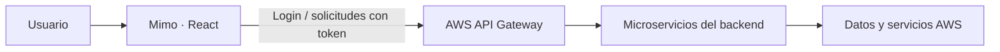

<div align="center">

# mimo.
### Personas primero.

Un espacio para conectar personas, acompañar su talento y gestionar el trabajo.

**Frontend HCM · Grupo 2 · UTEC**


[Comenzar](#inicio-rápido) · [Módulos](#módulos) · [Pruebas](#pruebas-y-estado-de-integración) · [Despliegue](#despliegue) · [Documentación](#documentación)

</div>

---

## Conoce Mimo

Mimo es la interfaz de un sistema **Human Capital Management** para administrar empleados, nóminas, asistencia, contratación y desempeño. Reúne los módulos en una experiencia responsive, con navegación por rol y un espacio de trabajo asociado a la empresa del usuario.

El frontend consume siete APIs del [proyecto backend](https://github.com/MikoIOS/ProyectoFinalCloud). La aplicación utiliza las cuentas y los datos del backend; no incorpora credenciales ni un acceso que omita la autenticación.

> [!IMPORTANT]
> **Estado de verificación · 12 de noviembre de 2026**
>
> Build, análisis de código y **20 pruebas unitarias** aprobados. **159 comprobaciones de interfaz con APIs simuladas** para cuatro roles. Consultas reales: **17/17** para Administración de Andina y **9/9** para Empleado de Pacífico, sin modificar registros de negocio. Registro de empresas con RUC integrado con `POST /auth/register`.
>
> **Publicado:** https://main.d2d9bbvg1i7lcp.amplifyapp.com · [Evidencia](docs/deployment-latest.json)

## Módulos

Las siguientes funcionalidades están implementadas en la interfaz contra los contratos disponibles. Su implementación no equivale a una certificación de funcionamiento en AWS.

| Área | Funcionalidades |
| --- | --- |
| **Inicio** | Resumen del equipo, distribución por área, nómina del mes e información personal según el rol. |
| **Personas** | Alta, ficha, edición, cambios de estado, cese, filtros y paginación. |
| **Organización** | Consulta de la estructura por área o jefe directo. |
| **Usuarios y perfil** | Gestión de cuentas, roles, datos de contacto y cambio de contraseña. |
| **Nóminas** | Boletas, PDF, planillas, generación y recálculo asíncrono, conceptos y liquidaciones. |
| **Bandas salariales** | Consulta, alta y actualización. |
| **Asistencia y ausencias** | Entrada y salida, registro manual, reportes CSV, solicitudes, resolución y saldo. |
| **Reclutamiento** | Vacantes, postulaciones, carga de CV mediante URL firmada y etapas de contratación. |
| **Onboarding** | Creación, consulta y finalización de tareas de incorporación. |
| **Desempeño** | Evaluaciones, objetivos, competencias, puntajes y reconocimientos. |
| **Notificaciones** | Consulta, filtros y marcado de lectura. |

### Roles y empresas

La navegación contempla **Administración RR. HH., Gerencia, Reclutamiento y Empleado**. Cada sesión identifica la empresa del usuario mediante `tenant_id`.

Los controles visuales se complementan con la autorización del servidor: **el backend debe validar los permisos y el aislamiento entre empresas**. Las restricciones conocidas están documentadas en [Limitaciones del backend](docs/LIMITACIONES_BACKEND.md).

## Inicio rápido

**Requisitos:** Node.js **22.18 o superior**, npm y una cuenta de aplicación proporcionada por el equipo.

```bash
git clone https://github.com/Armandorc7/frontend_mimo.git
cd frontend_mimo
npm ci
npm run dev
```

Abre la dirección que muestre Vite en la terminal. Por defecto utiliza el puerto `5173`; si está ocupado, elige el siguiente disponible.

**No necesitas iniciar sesión en la consola de AWS para utilizar Mimo.** Necesitas una cuenta válida de la aplicación y que las APIs desplegadas estén operativas.

### Configuración de las APIs

Las URLs predeterminadas están en [src/lib/api.ts](src/lib/api.ts). Para usar otro entorno:

```bash
cp .env.example .env.local
```

Edita las variables correspondientes en `.env.local` y reinicia Vite.

> [!CAUTION]
> Las variables `VITE_*` se incluyen en el código público del navegador. Utilízalas para URLs públicas; nunca para claves AWS, contraseñas o tokens.

## Cómo se conecta



El cliente centraliza las peticiones de usuarios, empleados, nóminas, asistencia, reclutamiento, desempeño y notificaciones.

- **Sesión:** el token se mantiene en memoria. Recargar o cerrar la pestaña requiere volver a iniciar sesión.
- **Expiración:** un token vencido o un HTTP 401 de una operación autenticada devuelve al acceso. No hay renovación automática porque el backend no ofrece ese endpoint.
- **Errores:** los formularios muestran los errores del servicio. Las escrituras no se reintentan automáticamente.
- **Fechas:** las operaciones utilizan la zona horaria `America/Lima`.

## Pruebas y estado de integración

| Verificación | Resultado registrado |
| --- | --- |
| Compilación de producción y TypeScript | Correctos |
| Pruebas unitarias del cliente | 19 aprobadas |
| Interfaz con respuestas demo, en el entorno local de desarrollo | 153 comprobaciones aprobadas |
| Login real con cuatro cuentas | HTTP 500 |
| Acceso sin token a siete rutas protegidas | HTTP 401 |
| Preflight CORS de siete servicios | HTTP 200 |
| Cuatro rutas de salud `/ping` | HTTP 500 |
| CRUD autenticado, S3, PDF y eventos reales | Pendientes de verificación |

La prueba demo local cubrió 12 rutas, cuatro roles y tres tamaños de pantalla, además de flujos seleccionados de formularios y sesión. **Usó respuestas controladas y no demuestra que AWS funcione.** El ejecutor está en `tests/demo-ui.mjs`; la evidencia de la última mejora está en `docs/qa-2026-11-12/`.

### Validar el cliente

```bash
npm test
npm run lint
npm run check
npm run build
```

Las pruebas unitarias usan respuestas controladas del transporte. No modifican los datos del backend.

### Consultar el backend real

Proporciona `HCM_TEST_EMAIL` y `HCM_TEST_PASSWORD` mediante el entorno y ejecuta:

```bash
npm run test:live
```

El ejecutor realiza login y un subconjunto de consultas según el rol. No crea empleados, genera planillas ni modifica registros de negocio. Repite la comprobación con cuentas de distintos roles y empresas; no guardes sus contraseñas en el repositorio.

Si login devuelve HTTP 500, el responsable del backend debe revisar las integraciones y los logs de AWS. Sin un token válido no se puede completar la verificación autenticada.

## Despliegue

El frontend genera un sitio estático en `dist/`:

```bash
npm ci
npm test
npm run build
npm run preview
```

`preview` permite revisar localmente la compilación. Para alojarla en **AWS Amplify Hosting**:

1. Despliega el contenido de `dist/` o utiliza [amplify.yml](amplify.yml) para configurar la compilación.
2. Configura las [reglas de reescritura SPA](docs/amplify-rewrites.json) para permitir la recarga de rutas internas.
3. Revisa los encabezados de [customHttp.yml](customHttp.yml), especialmente los destinos de API y S3.
4. Comprueba desde el dominio publicado el login, CORS, las rutas internas, las descargas y los permisos por rol.

Publicar el sitio no corrige un error del backend. La entrega funcional requiere validar ambos componentes juntos.

## Estructura del proyecto

```text
src/
├── components/ui.tsx   # Formularios, tablas, diálogos y controles compartidos
├── features/           # Pantallas de cada dominio HCM
├── lib/                # Cliente API, sesión, tipos y formatos
├── App.tsx             # Acceso, navegación, rutas y controles por rol
├── App.css             # Estilos de la aplicación
└── index.css           # Estilos generales
tests/                  # Pruebas unitarias y consultas reales
docs/                   # Contratos, verificación y limitaciones
amplify.yml             # Configuración de compilación para Amplify
customHttp.yml          # Encabezados de seguridad
```

## Documentación

| Recurso | Contenido |
| --- | --- |
| [Contratos de API](docs/CONTRATOS.md) | Operaciones y contratos utilizados por el cliente. |
| [Verificación](docs/VERIFICACION.md) | Comprobaciones registradas y pasos de validación. |
| [Limitaciones del backend](docs/LIMITACIONES_BACKEND.md) | Funcionalidades ausentes y restricciones que requieren trabajo del servidor. |
| [Configuración de entorno](.env.example) | Variables públicas para las URLs de los servicios. |
| [Backend de referencia](https://github.com/MikoIOS/ProyectoFinalCloud) | Microservicios y documentación del proyecto. |

---

<div align="center">

**mimo.** · Personas primero.  
Proyecto HCM · Grupo 2 · UTEC

</div>


## Mejoras de uso — 12 de noviembre de 2026

- Selectores de empleados por nombre, área o correo en formularios y filtros. La búsqueda se aplica a las personas cargadas; usa **Cargar más personas** para ampliar el listado. Los roles sin permiso de directorio conservan la entrada por código.
- Desde la ficha, enlaces a nóminas, asistencia, desempeño e incorporación con la persona ya seleccionada.
- Filtros activos y acción para limpiarlos; confirmaciones de cese, contratación y generación de planilla con sus efectos.
- Contratos TypeScript explícitos para empleados, vacantes, evaluaciones, notificaciones y tareas de incorporación. Los editores genéricos aún utilizan un tipo flexible.

Para repetir las comprobaciones:

```sh
npm run test:health
npm run test:demo
```

`test:health` hace 18 solicitudes públicas sin credenciales ni escrituras. Guarda códigos HTTP, CORS e identificadores de solicitud en `docs/health-latest.json`; falla si alguna comprobación no cumple lo esperado. No certifica el login ni las operaciones autenticadas.

`test:demo` requiere Google Chrome y el frontend servido en `http://127.0.0.1:5174`. Usa respuestas interceptadas exclusivamente en su navegador; no activa un modo demo en producción.

Los ZIP versionados y [el resultado previo](docs/qa-2026-11-12/RESULTADOS.md) pertenecen a la entrega anterior. El sitio publicado se compila desde el código actual de este repositorio; la evidencia vigente está en `docs/deployment-latest.json`. No se regeneraron esos ZIP históricos.

Guía para el compañero que administra AWS Academy: [despliegue manual paso a paso](docs/DESPLIEGUE_LEARNER_LAB.md). El paquete para compartir es `mimo-entrega-2026-11-12.zip`; se debe extraer y subir a Amplify únicamente el ZIP interior del sitio.


## Registro de empresas y trabajo con Git

Desde **¿Tu empresa es nueva? Crear cuenta** se solicitan empresa, RUC de 11 dígitos, nombre del administrador, correo y contraseña. La API asigna la empresa y el rol; el usuario inicia sesión automáticamente. El RUC se valida por formato, sin consultar SUNAT ni verificar la propiedad del correo.

Las ausencias siguen requiriendo 15 días calendario de anticipación, según la fecha de Lima. Las sesiones permanecen en memoria. El despliegue de Amplify es manual: un push no dispara una publicación automática.

Antes de editar: `git pull --ff-only`. Después de verificar: commit y push a este repositorio. El backend se mantiene en `MikoIOS/ProyectoFinalCloud`; no copiar el frontend dentro de su historial Git.

Para ejecutar las pruebas de interfaz con Chromium de Playwright y conservar las capturas fuera del repositorio:

```sh
PLAYWRIGHT_CHANNEL=chromium HCM_UI_URL=http://127.0.0.1:5174 HCM_QA_DIR=/tmp/mimo-qa npm run test:demo
```
